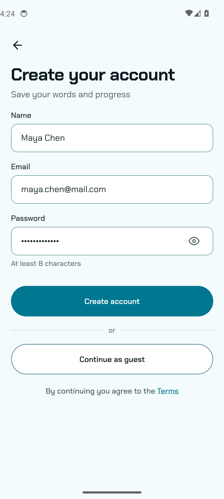
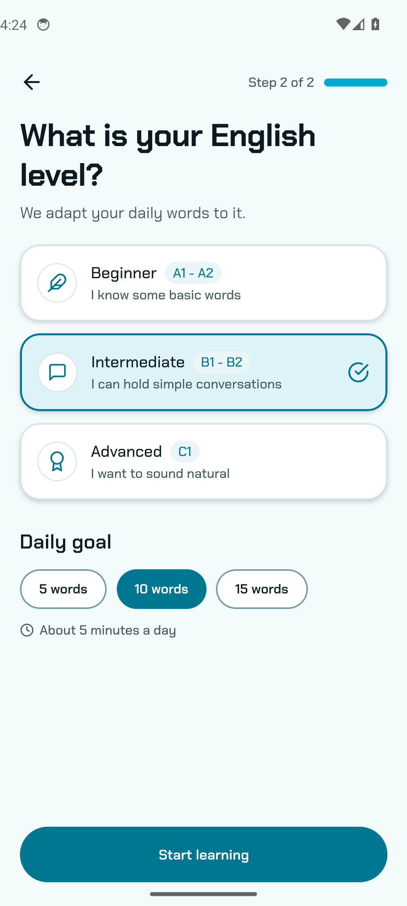
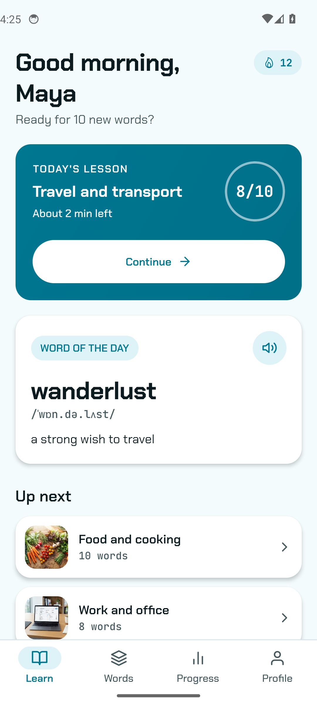
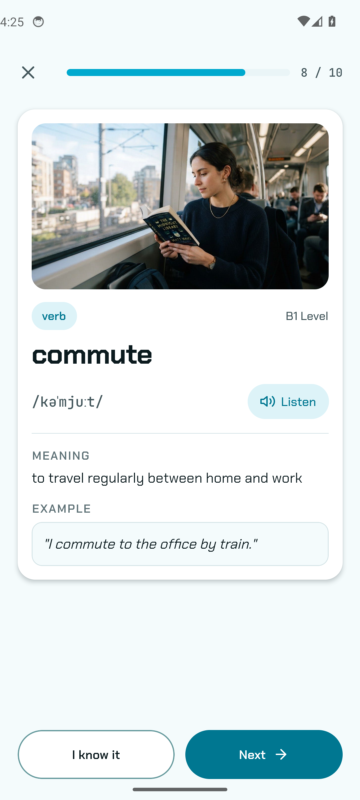
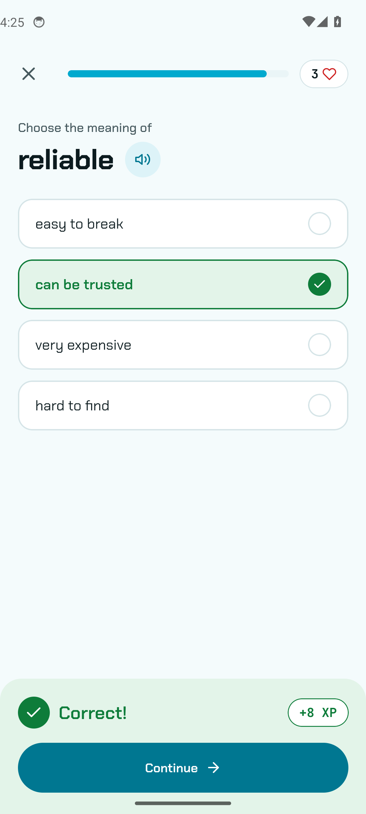
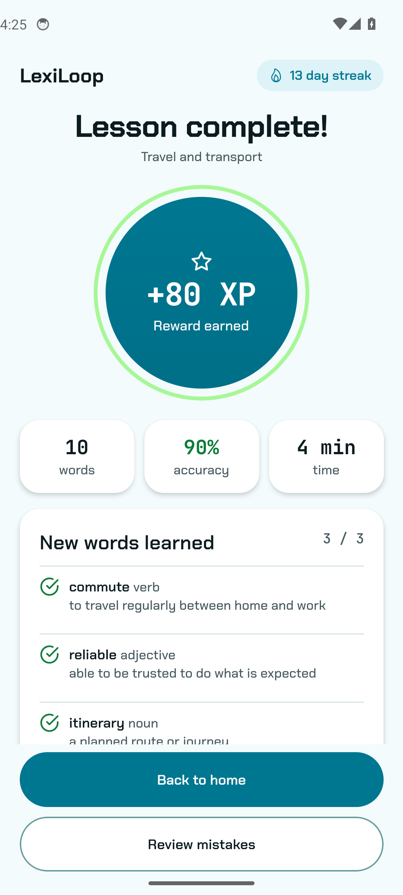
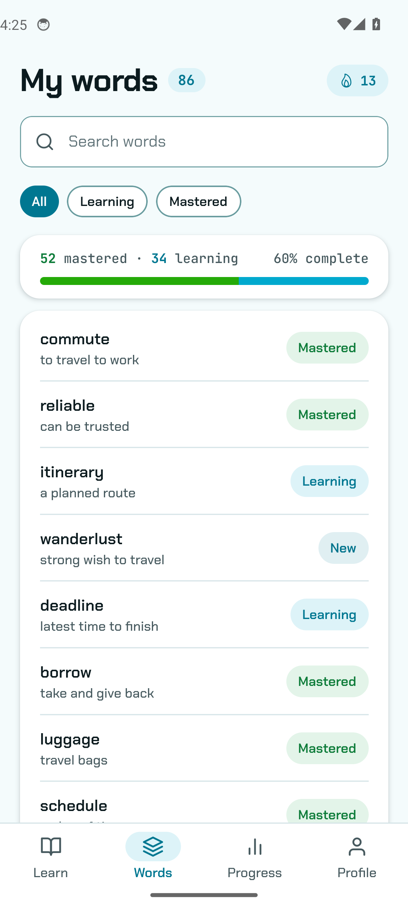
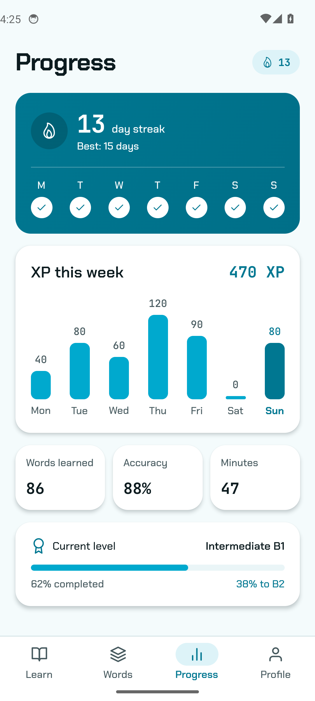
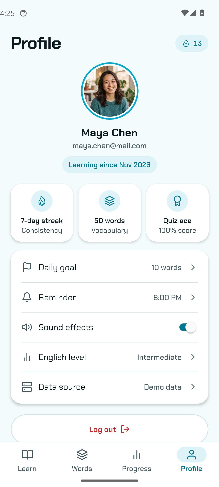
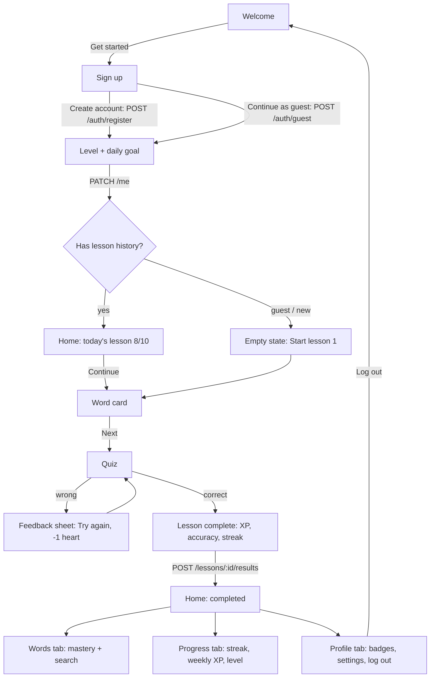

# LexiLoop - English vocabulary in short daily loops

A React Native (Expo) MVP of an English learning app: learners sign up, set their level and daily goal, learn new words on word cards, check themselves with short quizzes and follow their progress. Built with Redux Toolkit, TypeScript, an SQLite word cache and a small Node.js REST API.

## Demo


Captured on an Android emulator. The same codebase builds for iOS.

## Screens

| Welcome | Sign up | Level + daily goal | Home |
|---|---|---|---|
|  |  |  |  |

| Word card | Quiz | Lesson complete | My words |
|---|---|---|---|
|  |  |  |  |

| Progress | Profile |
|---|---|
|  |  |

## What it shows

- **Registration and profile**: sign-up form with validation (name, email, 8+ character password) or guest mode; level (A1 to C1) and daily goal saved to the profile; profile with badges, daily goal, reminder, sound toggle and log out.
- **Learn new words**: word card with photo, part of speech, phonetics, meaning, example and a (simulated) pronunciation button.
- **Short exercises**: multiple-choice quiz with instant feedback: correct answers slide up a success sheet with XP, wrong ones shake the options, cost a heart and explain the right meaning.
- **Lesson complete**: XP count-up, words, accuracy and time, the words learned and the updated streak.
- **Track progress**: streak card, weekly XP bar chart, totals and progress to the next level; the words list moves words from Learning to Mastered.
- **First-run state**: a guest sees an empty Learn tab with "Start lesson 1" instead of the dashboard.
- **Animations and transitions**: stack slide/fade transitions between screens, staggered fade-in content, spring press feedback on every tappable, animated progress bars and chart bars, the quiz feedback sheet and the XP counter.

## App flow



## Architecture

```
src/
  app/            Expo Router screens: onboarding, (tabs)/learn|words|progress|profile, lesson/word|quiz|complete
  components/     shared UI: Button, Card, Chip, Field, TabBar, ProgressBar, FadeIn, ScalePressable
  store/          Redux Toolkit: session, lesson, words, progress slices (async thunks call the API)
  api/client.ts   typed REST client; HTTP adapter for the Node.js API or an in-app mock adapter
  db/cache.ts     expo-sqlite offline word cache (Words tab falls back to it without network)
  logic/          pure rules (XP, accuracy, mastery, streak, filters, sign-up validation) + node:test
  data/           models, seed content, bundled photos
  theme/tokens.ts design tokens from design/DESIGN.md
server/           dependency-free Node.js REST API (auth, profile, lesson, words, results) + tests
design/           Google Stitch screens (HTML + PNG), DESIGN.md, brief and logo
```

- **State**: one Redux store. Screens dispatch thunks (`register`, `saveLevel`, `fetchLesson`, `finishLesson`, `fetchWords`); finishing a lesson updates lesson results, word mastery and progress (streak, XP, totals) in their own slices.
- **Backend**: `src/api/client.ts` defines the contract. With `EXPO_PUBLIC_API_URL` set, the app calls the Node.js API in `server/`; without it, a mock adapter returns the same data so the app runs offline.
- **Storage**: words are cached in SQLite after every successful fetch.
- **Design**: built from the Stitch design in `design/` (Chakra Petch + JetBrains Mono, teal palette, one icon set).

## Run

```bash
npm install
npm run typecheck && npm test      # TypeScript + unit tests (learning rules and API)
npx expo start                     # open in Expo Go or an emulator

# optional: real backend
npm run api                        # Node.js API on :4000
EXPO_PUBLIC_API_URL=http://<your-lan-ip>:4000 npx expo start
```
